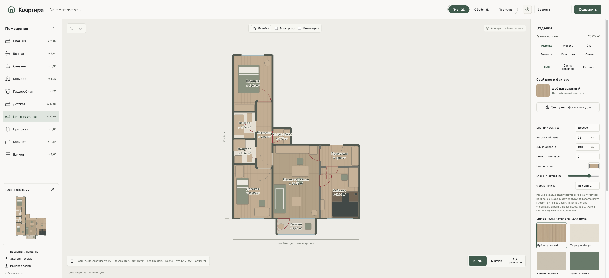

# Apartment Studio

[](https://github.com/alexandryasukaitisss-cmd/apartment-studio/actions/workflows/ci.yml)

**Live demo:** <https://alexandryasukaitisss-cmd.github.io/apartment-studio/>



Apartment Studio helps you plan a renovation in the browser. Start with a demo apartment or import your own JSON project, then walk through a 2D plan and a 3D view, try wall and floor finishes, place furniture, mark doors, windows, sockets, and get a material and work estimate.

Everything stays on your device. There is no account, cloud sync, or telemetry.

The demo runs entirely in the browser. Product URL import needs the local server; offline HTML/text import and project JSON import work without it.

Version 0.1.0. MIT.

Русская версия: [README.ru.md](README.ru.md).

## Demo and your own project

The first screen offers two paths:

- **Открыть демо** loads a demonstration apartment with a complete room layout, furniture, finishes, and estimate data.
- **Импортировать свой проект** loads a JSON export from this app or another compatible project.

The demo is a sample, not a measurement. Replace its geometry in **Размеры** or import your own project before buying materials.

## Run

Requirements: Node.js 20 or newer.

```sh
npm ci
npm run build
npm start
```

Open <http://127.0.0.1:4317>. The local server binds only to loopback.

For development, run the API and Vite in two terminals:

```sh
npm run server
npm run dev
```

`npm run dev` serves the UI on a Vite port and proxies `/api` to `127.0.0.1:4317`.

## What is included

- 2D plan with rooms, walls, doors, windows, furniture, electrical points, engineering items, a ruler, and door swings.
- 3D scene and walk-through camera with room-aware movement.
- Finishes by surface, accent walls, custom color/texture, physical repeat, and roughness.
- Furniture catalog, rotation, elevation, collision warnings, and room boundaries.
- Up to 20 design variants with independent finishes, furniture, lighting, electrical, and engineering layers.
- Material estimate: floor/wall/ceiling areas, openings, reserve, whole packs, work rates, furniture/tech prices, and variant comparison.
- Export: project JSON, estimate CSV, and a work brief for builders/electricians (HTML/PDF).
- Offline product import from saved HTML or pasted characteristics, plus an optional local URL reader for supported stores.
- Undo/redo, autosave to IndexedDB, and explicit project export/import.

## Privacy

- The project is stored in IndexedDB in your browser.
- Exported JSON may contain uploaded photos and personal measurements. Treat it as private data.
- The optional product URL reader contacts only the URL you enter and the page's image URL. It is a local loopback service, not a proxy for arbitrary browsing.
- No analytics, accounts, or remote storage.

## Limits

- The demo geometry is approximate and is not a measured survey or construction drawing. Verify every dimension before purchase or construction.
- The 3D view is a visual approximation, not a photorealistic render.
- Collision checks use static furniture envelopes. They do not model door swing, human movement, appliance operation, or structural loads.
- Store import compatibility is best-effort. Some stores block requests, require JavaScript, or do not publish dimensions; manual input remains available.
- This is a planning tool, not engineering, electrical, or structural advice.

## Tests

```sh
npm test          # 208 app tests
npm run test:server # 44 server tests
npm run build
```

The public tree does not include the native macOS wrapper or the Node runtime used by the private build. It runs as a local web app.

## License

MIT. See [LICENSE](LICENSE).
