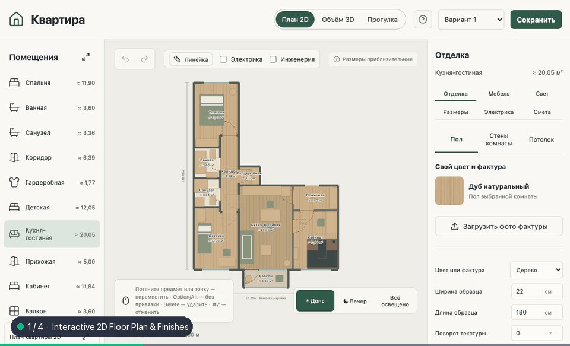

# Apartment Studio

[](https://github.com/alexandryasukaitisss-cmd/apartment-studio/actions/workflows/ci.yml)

**Живое демо:** <https://alexandryasukaitisss-cmd.github.io/apartment-studio/>



Apartment Studio помогает спланировать ремонт в браузере. Начните с демо-квартиры или импортируйте свой JSON-проект, затем пройдите по плану 2D и сцене 3D, примерьте отделку стен и пола, расставьте мебель, отметьте двери, окна и розетки и получите смету материалов и работ.

Всё остаётся на устройстве. Нет аккаунта, облачной синхронизации и телеметрии.

Демо работает полностью в браузере. Импорту по URL товара нужен локальный сервер; офлайн-импорт HTML/текста и импорт JSON проекта работают без него.

Версия 0.1.0. MIT.

English version: [README.md](README.md).

## Демо и свой проект

На первом экране два пути:

- **Открыть демо** загружает демонстрационную квартиру с комнатами, мебелью, отделкой и сметой.
- **Импортировать свой проект** загружает JSON-экспорт этого приложения или совместимого проекта.

Демо — это образец, а не обмер. Замените геометрию в разделе **Размеры** или импортируйте свой проект до закупки материалов.

## Запуск

Требуется Node.js 20 или новее.

```sh
npm ci
npm run build
npm start
```

Откройте <http://127.0.0.1:4317>. Локальный сервер слушает только loopback.

Для разработки запустите API и Vite в двух терминалах:

```sh
npm run server
npm run dev
```

`npm run dev` поднимает UI на порту Vite и проксирует `/api` на `127.0.0.1:4317`.

## Что входит

- План 2D: комнаты, стены, двери, окна, мебель, электрика, инженерия, линейка, дуги открывания и конус камеры.
- Синхронный режим **2D + 3D рядом**, 3D-объём и прогулка с готовыми «жизненными» ракурсами, сохранёнными видами, авто-туром и фигурой человека 186 см для масштаба.
- **4 стадии ремонта в 3D**: бетон, черновая/инженерия, чистовая отделка и квартира с мебелью.
- **2D-развёртка стен** с точными высотами розеток, проёмов и мебели (экспорт в SVG) + **шторка сравнения вариантов «До / После»**.
- Детализация 3D: рельефные текстуры (bump maps) + освещение RoomEnvironment IBL, 3D-двери (с наличниками или скрытые), плинтусы, шторы, 3D-розетки на стенах, 5 готовых стилей всей квартиры в 1 клик и локальный импорт `.glb`/`.gltf` моделей.
- **Аудит планировки**: чистовые размеры после штукатурки/стяжки/потолка, проверка заноса крупной мебели от входа и поворотов в коридоре, расчёт уклона канализации до стояка, контроль дверей санузлов, бликов ТВ и перекрытия окон, грязная зона прихожей, индекс хранения и бытовой хоз-чеклист.
- **Дорожная карта ремонта (7 этапов)**, связанная с обмерами и сметой, расчёт покрытий/расходников/работ и сравнение до 20 вариантов.
- Экспорт: JSON проекта, CSV сметы, SVG развёртки и печатное ТЗ для мастеров/электрика (HTML/PDF).
- Офлайн-импорт товара из сохранённого HTML или вставленного текста; опциональное чтение URL поддерживаемых магазинов.
- Отмена/повтор, автосохранение в IndexedDB и явный экспорт/импорт проекта.

## Приватность

- Проект хранится в IndexedDB в вашем браузере.
- Экспортированный JSON может содержать загруженные фото и личные размеры. Считайте его приватными данными.
- Опциональное чтение URL товара обращается только к указанному адресу и URL изображения страницы. Это локальный loopback-сервис, а не прокси для произвольного браузинга.
- Нет аналитики, аккаунтов и удалённого хранения.

## Ограничения

- Геометрия демо приблизительная. Это не обмер и не строительный чертёж. Проверяйте каждый размер до закупки и работ.
- 3D — визуальное приближение, не фотореалистичный рендер.
- Проверка пересечений использует статичные габариты мебели. Она не учитывает открывание дверей, движение человека, работу техники и нагрузки на перекрытие.
- Совместимость импорта магазинов — best-effort. Некоторые магазины блокируют запросы, требуют JavaScript или не публикуют размеры; ручной ввод остаётся.
- Это планировщик, а не инженерное, электрическое или строительное заключение.

## Тесты

```sh
npm test          # 221 тест приложения
npm run test:server # 44 теста сервера
npm run build
```

В публичном дереве нет нативной macOS-обёртки и Node-runtime приватной сборки. Приложение запускается как локальное веб-приложение.

## Лицензия

MIT. См. [LICENSE](LICENSE).
